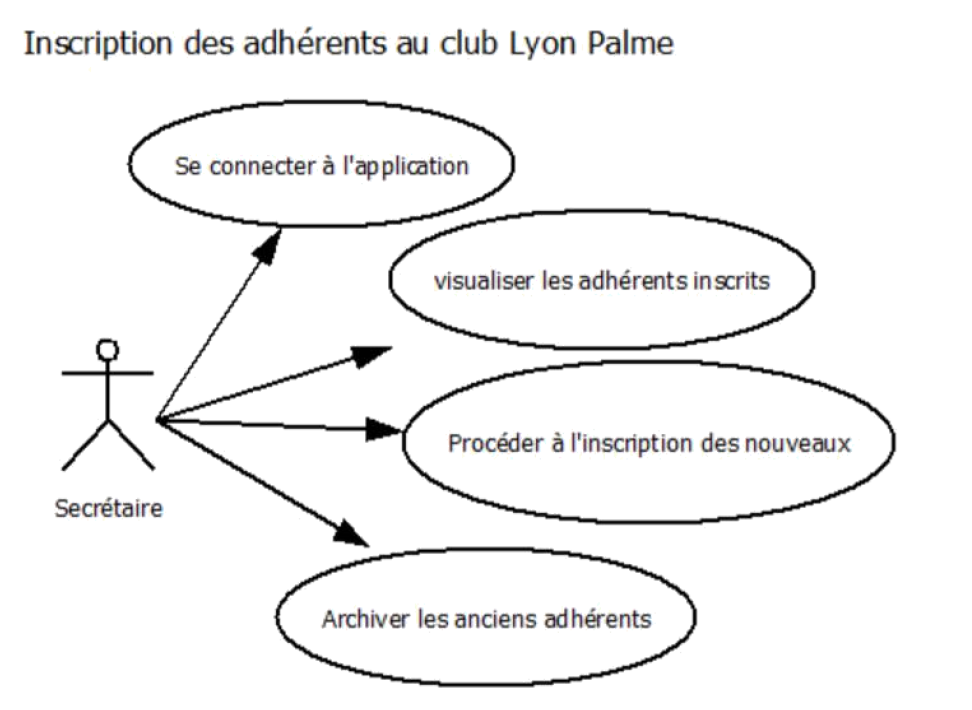
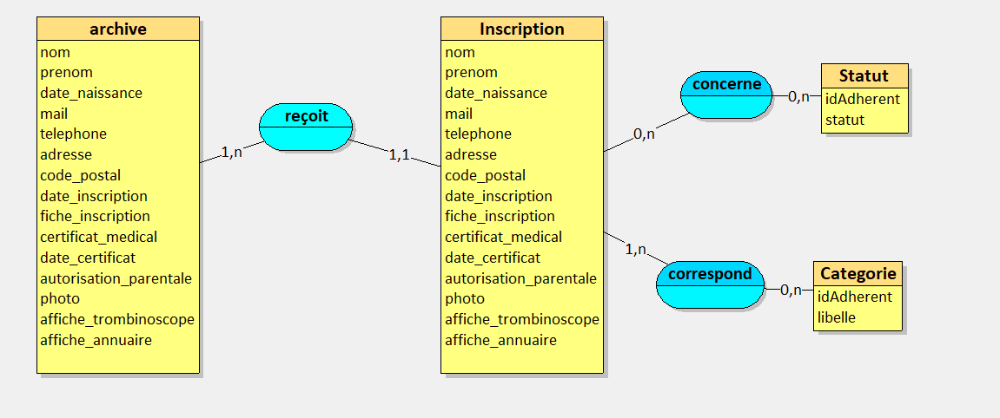
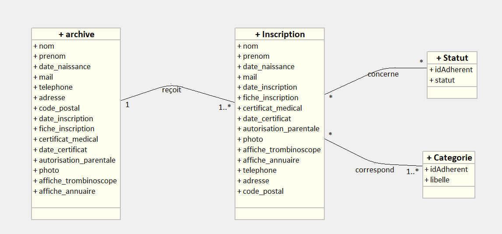
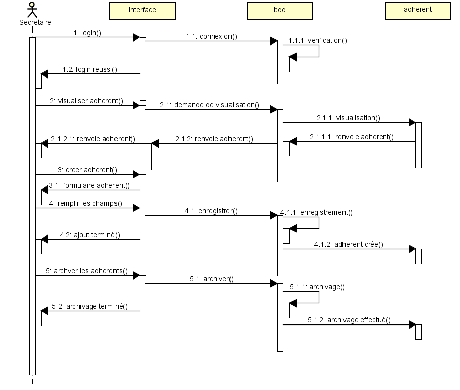

```
                                                                                  
  _                       _____      _                
 | |                     |  __ \    | |               
 | |    _   _  ___  _ __ | |__) |_ _| |_ __ ___   ___ 
 | |   | | | |/ _ \| '_ \|  ___/ _` | | '_ ` _ \ / _ \
 | |___| |_| | (_) | | | | |  | (_| | | | | | | |  __/
 |______\__, |\___/|_| |_|_|   \__,_|_|_| |_| |_|\___|
         __/ |                                        
        |___/                                         
```

<p align="center">
  
  
  
</p>
<p align="center">
  <a href="https://github.com/Rateur/Lyonpalme_exam/graphs/contributors">
    
  </a>
</p>

## Sommaire
1. [À propos](#apropos)
2. [Technologies](#technologies)
3. [Structure du dépôt](#structure)
4. [Installation](#installation)
5. [Authentification & comptes](#authentification)
6. [Navigation](#navigation)
7. [Fonctionnement & limites](#utilisation)
8. [Annexes](#annexes)
9. [Sources](#sources)
10. [Remerciements](#remerciements)

## <a id="apropos"></a>À propos
Projet d'examen du BTS SIO option SLAM, mai 2023, à Sup'Chassagnes (Oullins, 69). Équipe de quatre en méthode Scrum, encadrée par Mme Chataing.

- **Équipe** : Yasser Bouraghda, Tom Perrat, Milan Beretoni, Valentin Peries (Scrum Master).
- **Application** : LyonPalme gère l'inscription et le suivi des adhérents d'un club fictif dont les adhérents sont des nageurs.
- **Secrétaires** : créent les comptes, modifient et archivent les fiches, suivent les cotisations.
- **Nageurs** : modifient leurs informations et consultent le trombinoscope.

Objectifs du projet :
- Couvrir un cycle d'inscription complet : création, mise à jour, archivage.
- Chiffrer les données personnelles des fiches.
- Pratiquer Django : formulaires, utilisateurs, expressions régulières.
- Documenter pour un jury externe : UML, MCD, diagramme de séquence, user stories.
- Séparer les parcours secrétaire et nageur.

## <a id="technologies"></a>Technologies
<table align="center">
  <tr>
    <td align="center" width="150">
      <a href="https://www.python.org/" target="_blank" rel="noreferrer">
        
        <br /><sub><strong>Python 3.11</strong></sub>
      </a>
    </td>
    <td align="center" width="150">
      <a href="https://www.djangoproject.com/" target="_blank" rel="noreferrer">
        
        <br /><sub><strong>Django 4.1.4</strong></sub>
      </a>
    </td>
    <td align="center" width="150">
      <a href="https://getbootstrap.com/" target="_blank" rel="noreferrer">
        
        <br /><sub><strong>Bootstrap 5</strong></sub>
      </a>
    </td>
    <td align="center" width="150">
      <a href="https://www.sqlite.org/" target="_blank" rel="noreferrer">
        
        <br /><sub><strong>SQLite</strong></sub>
      </a>
    </td>
  </tr>
</table>

- **Django** : templates, ORM avec 6 migrations, vues sous forme de fonctions, routage par application.
- **Base de données** : SQLite, fichier `lyon_palme/db.sqlite3`. Pas de MongoDB.
- **Chiffrement** : `django-cryptography` chiffre les champs des fiches `Inscription` et `Archive`. Le fichier SQLite lui-même n'est pas chiffré. Le compte Django (`User`: identifiant, e-mail) ne l'est pas non plus.
- **Bootstrap** : chargé depuis un CDN (version 5.3.0) dans les templates.
- **Dépendances épinglées** (`lyon_palme/requirements.txt`) : `Django 4.1.4`, `django-cryptography 1.1`, `django-appconf 1.0.5`, `cryptography 38.0.4`, `cffi 1.15.1`, `pycparser 2.21`, `Pillow 9.3.0`, `asgiref 3.5.2`, `sqlparse 0.4.3`, `psycopg2 2.9.6`. `settings.py` n'utilise pas `psycopg2`.
- **Outils** : Git, Debian, Visual Studio Code 1.78.2.
- **Modélisation** : UML, MCD, diagramme de séquence, user stories.

## <a id="structure"></a>Structure du dépôt
```
Lyonpalme_exam/
├── README.md
├── docs/img/                    # icônes du README
├── dossier_technique/
│   ├── cdc - client léger - gestion des adhérents.pdf
│   ├── Documentation utilisateur.docx
│   ├── MCD.png
│   ├── UML.png
│   ├── sequence.png
│   └── userstory.png
└── lyon_palme/
    ├── inscription/
    │   ├── forms.py
    │   ├── logger.py            # journaux info.log et critic.log, non importé par les vues
    │   ├── models.py
    │   ├── regex.py             # validations mail, téléphone, code postal, mot de passe
    │   ├── migrations/
    │   ├── static/
    │   ├── templates/
    │   ├── tests.py             # vide
    │   ├── urls.py
    │   └── views.py
    ├── lyon_palme/
    │   ├── settings.py
    │   ├── urls.py
    │   ├── asgi.py
    │   └── wsgi.py
    ├── manage.py
    └── requirements.txt
```

## <a id="installation"></a>Installation
### Prérequis
-  Python 3.11 (3.11.4 en développement). Les versions épinglées datent de 2022 et ciblent Python 3.11 au plus.
-  Django 4.1.4, installé par `requirements.txt`.
-  Debian ou équivalent pour les commandes `apt` ci-dessous.
-  Visual Studio Code, au choix.

### Environnement et dépendances
```bash
git clone https://github.com/Rateur/Lyonpalme_exam.git
cd Lyonpalme_exam/lyon_palme
sudo apt update
sudo apt install python3-pip python3-venv
python3 -m venv venv
source venv/bin/activate  # Windows : venv\Scripts\activate
pip install -r requirements.txt
```
Si l'installation de `psycopg2` échoue à la compilation, retirez cette ligne de `requirements.txt` : `settings.py` ne s'en sert pas.

### Clé secrète
`SECRET_KEY` vient de la variable d'environnement `DJANGO_SECRET_KEY`. Sans elle, Django génère une clé aléatoire à chaque démarrage.

```bash
export DJANGO_SECRET_KEY="une-longue-valeur-secrète"  # PowerShell : $env:DJANGO_SECRET_KEY="..."
```

- Avec une clé aléatoire, les sessions ouvertes sont perdues à chaque redémarrage.
- À confirmer : `django-cryptography` dérive sa clé de chiffrement de `SECRET_KEY` par défaut. Si c'est le cas, les champs chiffrés déjà enregistrés deviennent illisibles avec une autre clé. Définissez alors une valeur fixe dès le premier lancement.

### Base de données et lancement
```bash
python manage.py migrate
python manage.py createsuperuser   # compte secrétaire
python manage.py runserver         # http://127.0.0.1:8000/inscription/
```
- SQLite ne demande ni identifiant ni mot de passe. La base `db.sqlite3` est ignorée par Git : elle se crée avec `migrate`.
- Pour un autre moteur (PostgreSQL, MySQL), modifier `DATABASES` dans `lyon_palme/settings.py`. Rien n'est prévu dans le dépôt pour cela.
- `DEBUG = True` et `ALLOWED_HOSTS = []` : usage local uniquement.
- Les e-mails (réinitialisation de mot de passe) ne partent pas. Django les écrit dans `lyon_palme/sent_emails/` (`EmailBackend` fichier).

## <a id="authentification"></a>Authentification & comptes
### Secrétaire
Un secrétaire est un superutilisateur Django, créé avec `createsuperuser`. Compte utilisé pour la démonstration, à recréer en local :

| Identifiant | E-mail                | Mot de passe |
|-------------|-----------------------|--------------|
| secretaire  | secretaire@gmail.com  | C1Secret!    |

### Adhérents (nageurs)
Un secrétaire crée le compte avec le formulaire d'inscription.
- **Identifiant** : initiale du prénom + nom, casse saisie conservée (Jean Dupont donne `JDupont`).
- **Mot de passe initial** : date de naissance au format `AAAA-MM-JJ` (champ date du formulaire).
- À la première connexion, `login_count` vaut 1 et le nageur est redirigé vers `change_password`.
- Politique du nouveau mot de passe (`Regex.verif_mdp`) : une minuscule, une majuscule, un chiffre, puis soit 12 caractères avec un caractère spécial, soit 14 caractères.
- Le nouveau mot de passe doit différer de l'ancien.

## <a id="navigation"></a>Navigation
Base : `http://127.0.0.1:8000/inscription/`

| Route | Rôle |
|-------|------|
| `` | Accueil public |
| `politique_confidentialite` | Politique de confidentialité |
| `login_nageur` | Connexion nageur, lien « Mot de passe oublié » |
| `login_secretaire` | Connexion secrétaire, même lien |
| `accueil_nageur` | Espace nageur |
| `accueil_nageur/modification_nageur/` | Le nageur modifie ses informations |
| `accueil_nageur/trombinoscope/` | Trombinoscope |
| `accueil_secretaire` | Liste des adhérents |
| `inscription_form` | Création d'un adhérent |
| `accueil_secretaire/<id>/` | Fiche d'un adhérent |
| `accueil_secretaire/<id>/modification_nageur` | Modification par le secrétaire (cotisation comprise) |
| `accueil_secretaire/<id>/archiver_nageur` | Archivage |
| `change_password` | Changement de mot de passe |
| `logout_view` | Déconnexion |

Hors de `/inscription/` : `/admin/` (administration Django) et `/accounts/` (réinitialisation de mot de passe).

## <a id="utilisation"></a>Fonctionnement & limites
### Parcours type
1. Le secrétaire se connecte sur `login_secretaire`.
2. Il crée un adhérent avec `inscription_form`.
3. L'adhérent se connecte sur `login_nageur` avec son identifiant et sa date de naissance.
4. Il est redirigé vers `change_password`.
5. Ensuite, il utilise `accueil_nageur` : modifier ses informations, consulter le trombinoscope.

### Ce que fait le code
- **Création** : un compte Django et une fiche `Inscription` chiffrée.
- **Saisie** : des regex valident l'e-mail (minuscules), le téléphone français (`0[1-678]` puis 4 paires de chiffres) et le code postal.
- **Archivage** : `archiver_nageur` copie dans `Archive` le nom, le prénom, la date de naissance, le contact, l'adresse, la date d'inscription et la date de désinscription, puis supprime la fiche `Inscription`. Les pièces jointes et les préférences d'affichage ne sont pas copiées. Le compte Django reste.
- **Accès** : `@login_required` et un test sur `is_superuser` protègent les vues secrétaire.
- **Préférences** : l'adhérent choisit d'apparaître ou non dans le trombinoscope et l'annuaire. Seul le secrétaire modifie la cotisation.

### Limites
- `tests.py` est vide : aucun test automatisé.
- Le trombinoscope affiche cinq images de démonstration fixées dans la vue. Il ignore la préférence d'affichage.
- L'annuaire n'a pas de page : seule la préférence est enregistrée.
- Les champs `ImageField` (fiche d'inscription, certificat médical, autorisation parentale, photo) existent dans les modèles. Les champs d'envoi sont commentés dans `forms.py`.
- `Categorie` et `Statut` sont définis dans `models.py` et ne servent dans aucune vue.
- `Regex.verif_cp` refuse les codes dont le deuxième chiffre est 0 (par exemple 30000). La partie 971 à 974 de l'expression ne fonctionne pas comme annoncé.
- Le chiffrement des champs ne prouve pas une conformité RGPD. Aucune analyse n'est publiée dans le dépôt.
- Des scripts internes, non publiés, auraient servi à migrer des données Access vers SQLite puis MySQL. À confirmer : le dépôt n'en garde aucune trace.

## <a id="annexes"></a>Annexes
- **User story** : rôles et parcours principaux
  <p align="center"></p>

- **MCD** : entités et relations
  <p align="center"></p>

- **Diagramme de classes UML** : modèles Django
  <p align="center"></p>

- **Diagramme de séquence** : inscription et échanges secrétaire / nageur
  <p align="center"></p>

- Cahier des charges : [`cdc - client léger - gestion des adhérents.pdf`](dossier_technique/cdc%20-%20client%20l%C3%A9ger%20-%20gestion%20des%20adh%C3%A9rents.pdf)
- Documentation utilisateur : [`Documentation utilisateur.docx`](dossier_technique/Documentation%20utilisateur.docx)

## <a id="sources"></a>Sources
- [Documentation officielle Django](https://docs.djangoproject.com/fr/4.1/)
- [Guide Bootstrap 5](https://getbootstrap.com/docs/5.0/getting-started/introduction/)
- [Documentation Python 3.11](https://docs.python.org/3.11/)
- Cours et supports Sup'Chassagnes (Teams), fournis par Mme Chataing.
- Vidéos : [La formation complète Django (2022)](https://www.youtube.com/watch?v=Bn0k9DDYBZM&t=5502s), [Django Python](https://www.youtube.com/watch?v=tZ4LXyJAj3w&list=PLh-rUZWaw76H5XOcYneHhuvypENDCkpAf)

## <a id="remerciements"></a>Remerciements
- **Mme Chataing** pour son suivi et ses retours.
- L'équipe pédagogique du BTS SIO SLAM.
- Nos camarades de promotion pour leurs tests et leurs remarques.
